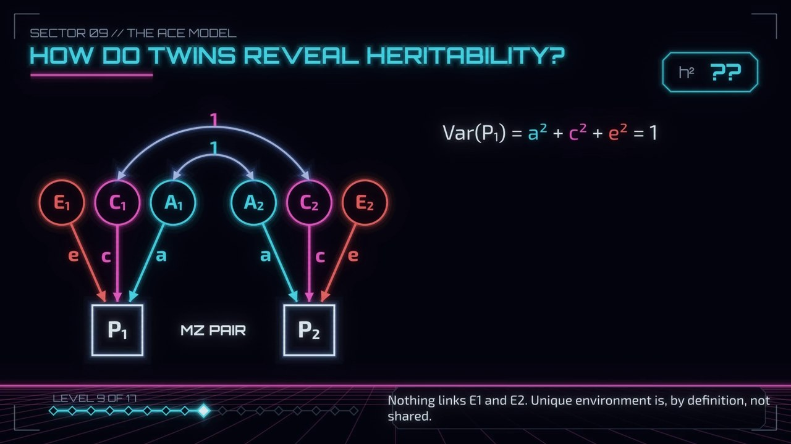

<!-- generated by tools/publish.R in the production folder; do not edit by hand -->

```{=html}
<header class="sector-head realm-twins">
<p class="hud"><a href="../realms/twins.html">REALM 02 // THE MIRRORLANDS</a> · SECTOR 09</p>
<h1 class="sector-title">The ACE path diagram</h1>
<p class="sector-question">Where do the twin equations come from?</p>
<p class="sector-meta"><span class="chip warm">IN PRODUCTION</span> 6-7 min</p>
</header>
<div class="screen still"><span class="screen-badge">IN PRODUCTION</span></div>
```

::: {.callout-note collapse="true" appearance="minimal"}
## The maths, slowly

Draft — last updated October 23, 2026.

Put every variable on a standard scale, so each has variance 1. A twin's score **P** is built from three latent
sources, each with variance 1: additive genes **A**, shared environment **C** and unique environment **E**. The paths
from them to P are **a**, **c** and **e**.

**Wright's tracing rules.** The covariance between two variables is the sum, over every allowed chain between them, of
the product of the path values along the chain. A chain may go backwards along arrows and then forwards, never
forwards then backwards. It passes through at most one double-headed arrow, and it visits no variable twice.

**One twin.** A variable's variance is its covariance with itself: the chains that leave P and come back.

$$\operatorname{Var}(P) = a^2 + c^2 + e^2 = 1$$

**Identical (MZ) pairs.** Twin 1's A correlates 1 with twin 2's A, and the C's correlate 1. The E's are not linked.

$$r_{MZ} = a^2 + c^2$$

**Fraternal (DZ) pairs.** The A's correlate ½, because DZ twins share half their segregating genes on average. The
C's still correlate 1.

$$r_{DZ} = \tfrac{1}{2}a^2 + c^2$$

**Subtract.** The shared environment cancels:

$$r_{MZ} - r_{DZ} = \tfrac{1}{2}a^2 \quad\Rightarrow\quad h^2 = a^2 = 2\,(r_{MZ} - r_{DZ})$$

With the running example (r_MZ = .70, r_DZ = .40): a² = .60, c² = .70 − .60 = .10, e² = 1 − .70 = .30.
:::

```{=html}
<nav class="sector-nav">
<a class="prev" href="twins-08.html">&larr; SECTOR 08 · Falconer's formula</a>
<a class="up" href="../realms/twins.html">REALM MAP</a>
<a class="next" href="twins-10.html">&rarr; SECTOR 10 · Fitting the model</a>
</nav>
```
